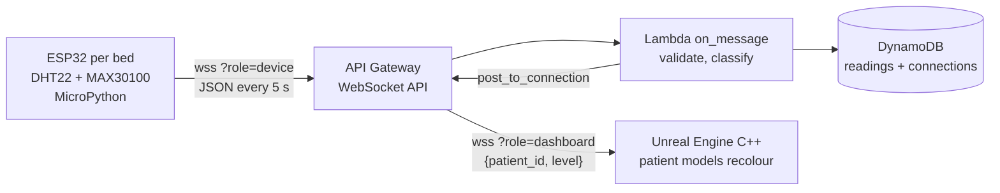

# Health Observatory

Real-time patient monitoring for a hospital ward. An **ESP32** at each bed reads a
temperature sensor (DHT22) and an optional pulse oximeter (MAX30100) and streams
the readings over a secure WebSocket to **AWS**. A Lambda function classifies every
reading as normal, elevated or high, stores it in **DynamoDB**, and pushes the result
to every open dashboard. The dashboard is an **Unreal Engine (C++)** scene where each
patient's 3D model turns **green, yellow or red**.

An individual undergraduate project (B.Tech CSE, JNTU Hyderabad, 2023) that I designed and built end to end: firmware, cloud and visualizer. Cleaned up,
fixed and tested in 2026.



| Folder | What it is |
|---|---|
| `device/` | ESP32 firmware (MicroPython): sensors, Wi-Fi, WebSocket client with reconnect |
| `cloud/` | Lambda handlers, AWS SAM template, unit tests |
| `visualizer/` | Unreal Engine 4.27 C++ module: WebSocket client and patient actors |
| `tools/` | Local gateway (runs the cloud side on a laptop), fake device and dashboard, end-to-end test |

## Message format

Device to cloud (`onMessage` route):
```json
{"action": "onMessage", "patient_id": "bed-01", "seq": 12, "temperature_c": 30.6, "humidity": 50.2}
```
Cloud to dashboards:
```json
{"patient_id": "bed-01", "level": 1, "status": "elevated", "temperature_c": 30.6, "ts": 1795644809749}
```
Levels: `0` normal (green), `1` elevated (yellow), `2` high (red). Thresholds are
environment variables (`NORMAL_MAX_C`, `ELEVATED_MAX_C`). The defaults (30 / 31 C)
match the classroom demo, where the DHT22 measured room air; use 37.5 / 38.5 for a
body-temperature probe.

## Run everything on a laptop (no AWS, no hardware)

```sh
pip install -r cloud/requirements-dev.txt websockets
python tools/local_gateway.py                 # terminal 1: stands in for API Gateway + DynamoDB
python tools/fake_dashboard.py                # terminal 2: prints what Unreal receives
MICROPYTHON=/path/to/micropython sh tools/run_device_on_laptop.sh   # terminal 3: the real device code, fake sensors
```
`tools/e2e_test.py` does all three and checks the dashboard receives levels 0, 1, 2, 0.

## Deploy to AWS

```sh
cd cloud
sam build && sam deploy --guided      # prints WebSocketUrl
```

## Flash the ESP32

1. Install MicroPython on the board.
2. Copy `device/config.example.py` to `device/config.py`, fill in Wi-Fi, `WS_URL` (ending in `?role=device`) and `PATIENT_ID`.
3. Upload `device/main.py`, `device/payload.py`, `device/config.py` and the `device/lib/` folder (for example with `mpremote cp -r device/* :`).

Wiring: DHT22 data on GPIO 14; MAX30100 SCL on GPIO 22 and SDA on GPIO 21 (optional; the
firmware runs without it).

## Unreal Engine visualizer

1. Copy `visualizer/Source` and `visualizer/Config` into your Unreal 4.27 project
   (the `Content` folder with Marketplace assets is not in this repo).
2. Set `ServerUrl` in `Config/DefaultGame.ini` (ending in `?role=dashboard`).
3. Place an `AFirstActor` per bed, give its `Body` a mesh and a material with a Vector
   Parameter named `Color` wired to Base Color, and set `PatientId` to the bed's ID.

## Tests

```sh
python -m pytest -q cloud/tests device/tests    # 32 unit tests
cfn-lint cloud/template.yaml
MICROPYTHON=/path/to/micropython python tools/e2e_test.py
```
CI runs all of these on every push, including the end-to-end test on a freshly built MicroPython.

## What was fixed in 2026

- **Crash in the Lambda:** a message with an `id` read `msg["id"]` after `msg` had been replaced by a string.
- **Gap in classification:** readings between 29 and 30 C matched no branch and returned nothing; bands are now continuous and configurable.
- **Level sent as a string** (`"3"`) while Unreal read it as an integer; it is now a number.
- **Hard-coded endpoint URLs and a Wi-Fi password** in the source; moved to `config.py` (git-ignored) and `DefaultGame.ini`.
- **Device:** a new hardware timer was created on every loop pass and sent from inside the timer callback; it is now one main loop that skips failed sensor reads and reconnects Wi-Fi and the WebSocket with backoff.
- **Device:** imported `uwebsockets` while the folder was named `uwebsocket`; added TLS server name (SNI) for API Gateway.
- **MAX30100 driver:** wrote the raw value 1600 into an 8-bit register and never cleared old mode bits; now uses the datasheet codes.
- **Cloud:** broadcasts only to dashboards (not back to devices), removes closed connections, validates input, and stores readings per patient and timestamp.
- **Unreal:** a null WebSocket was dereferenced every frame before the first connection; the client now reconnects on its own, and each actor shows its own patient instead of the last message received.
- **Removed medicine suggestions** from the server responses; the system reports a status, not a prescription.
